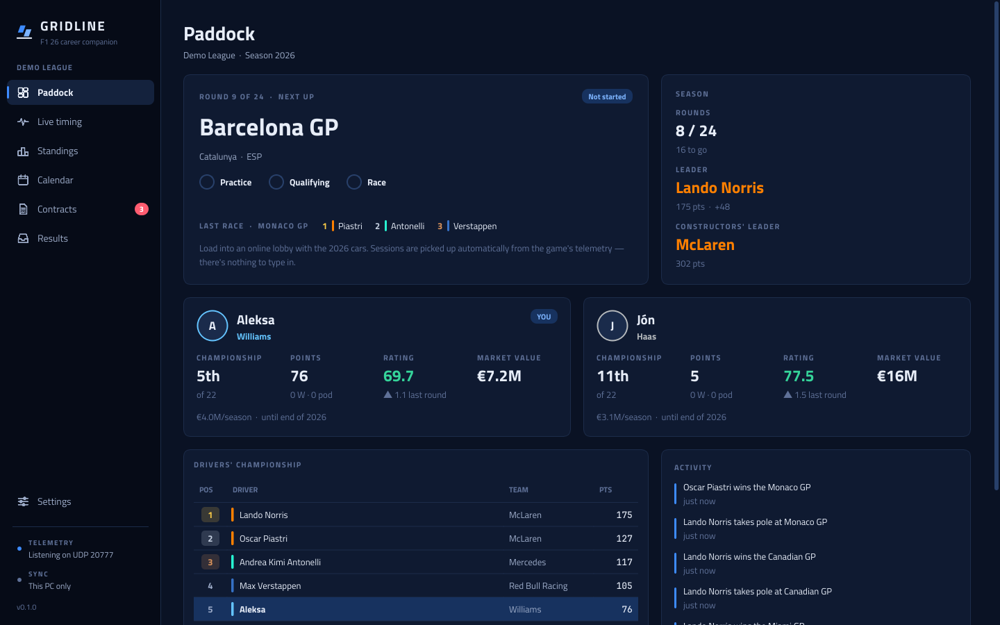
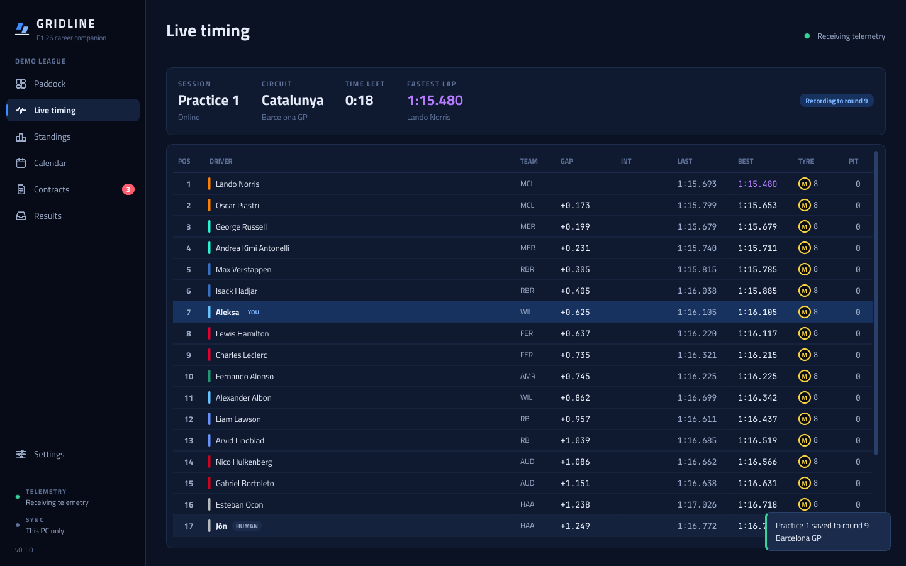
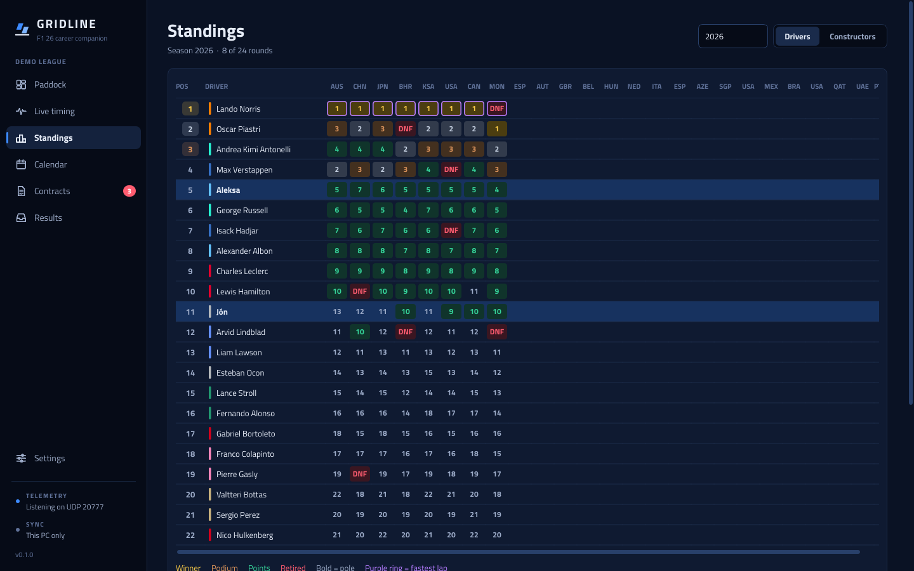
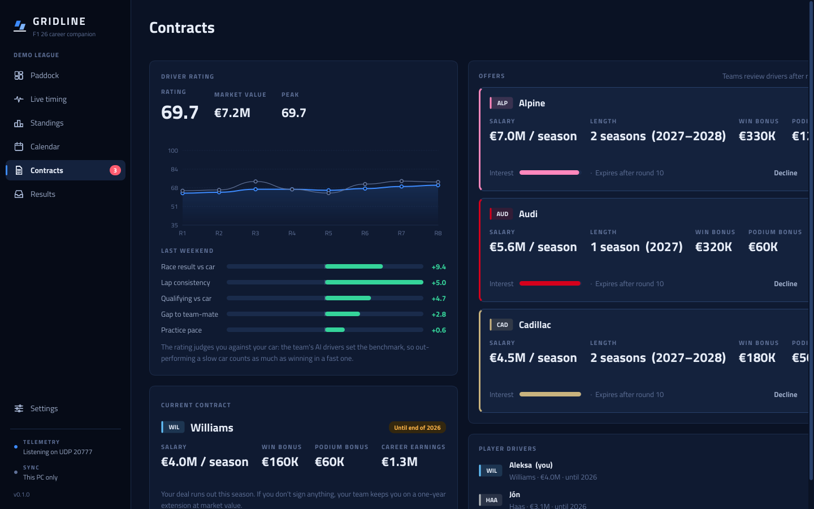
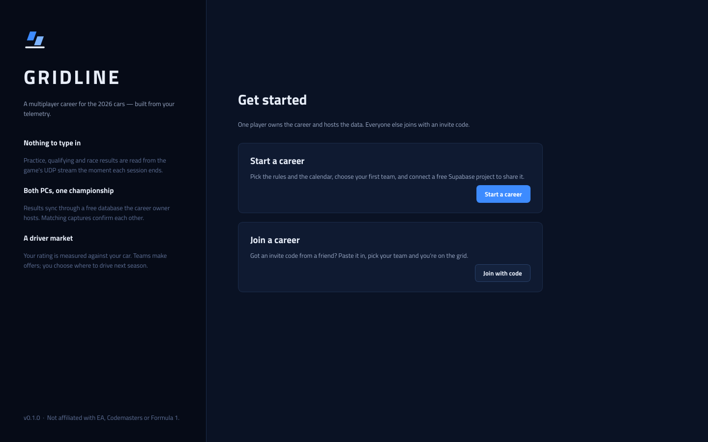

# Gridline

**A multiplayer career for the 2026 cars in F1 25, built from the game's UDP telemetry.**

The 2026 Season Pack for F1 25 has the new cars, teams and Madrid, but no two-player career. Gridline adds one.
You race in online lobbies, and the app reads every practice, qualifying and race result straight from the
telemetry stream. Each player's PC syncs those results to a free database hosted by the career owner, and the
app runs the championship, driver ratings, contracts and transfers on top of them.



| Live timing | Standings |
|---|---|
|  |  |

| Contracts | First run |
|---|---|
|  |  |

---

## What it does

- **Captures results automatically.** Positions, grid, best laps, fastest lap, pit stops, tyre stints,
  penalties, retirements and the team each driver used. All of it comes from the UDP stream, with no typing.
- **Live timing tower** while you drive, so it works well on a second monitor.
- **Shared career across PCs.** Both players capture every session. When the two copies match, the result is
  *confirmed*. If only one PC captured it, it counts as *provisional*. If the copies disagree, the owner picks
  the correct one.
- **Full championship:** drivers' and constructors' standings for the whole 22-car grid, a results matrix, a
  points progression chart, an editable 24-round 2026 calendar and custom points rules.
- **Driver rating** measured against your car. Your team's AI drivers set the benchmark for the weekend, and
  you're scored on race result versus that benchmark, qualifying, gap to your team-mate, lap consistency,
  practice pace and penalties.
- **Contracts and transfers.** Your rating sets your market value. Teams make offers after set rounds and at
  season end, and you sign or decline. Signed deals start the next season, and the app warns you if you load
  into the lobby in the wrong car.

## Requirements

- Windows, macOS or Linux with **Python 3.10+**
- **F1 25** with the **2026 Season Pack**, on PC. Console players can point the game's UDP output at a PC on the
  same network.
- For shared careers, a free **[Supabase](https://supabase.com)** project, owned by one player

## Install and run

```bash
git clone https://github.com/<you>/gridline.git
cd gridline
python -m venv .venv
.venv\Scripts\activate          # macOS/Linux: source .venv/bin/activate
pip install -r requirements.txt
python main.py
```

## In-game telemetry settings

**Settings → Telemetry Settings**

| Setting | Value |
|---|---|
| UDP Telemetry | On |
| UDP Broadcast Mode | Off |
| UDP IP Address | `127.0.0.1` (or the IP of the PC running Gridline) |
| UDP Port | `20777` (changeable in Gridline → Settings) |
| UDP Send Rate | 20 Hz or higher |
| UDP Format | 2026 (2025 also works) |
| Your Telemetry | Public, so the other player's PC can see your laps |
| Show online names | On, which helps match players in the lobby |

## Setting up a shared career

**The owner** (one-time, about 3 minutes):

1. Create a free project at [supabase.com](https://supabase.com).
2. In the project, open **SQL Editor → New query**. Paste [`gridline/assets/schema.sql`](gridline/assets/schema.sql)
   (or use *Copy setup SQL* in the app) and press **Run**.
3. Open **Project Settings → API** and copy the **Project URL** and the **anon / publishable key**.
4. In Gridline, choose **Start a career**, pick your team, choose *Shared*, paste the URL and key, then
   *Create career*.
5. Send the **invite code** to the other player. You can find it again under *Settings → Sharing*.

**Everyone else:** choose **Join a career**, paste the code, enter your name and in-game name, and pick a team.

> The invite code contains the project URL and its public key. Supabase designs that key to be public. The
> database rules in `schema.sql` only let the app *read* and *append* events, never edit or delete them. Only
> share the code with people you race with.
>
> Free Supabase projects pause after about a week with no activity. If that happens, open the Supabase
> dashboard and click *Restore*; nothing is lost.

## Racing a round

1. Open Gridline on both PCs. The sidebar should show *Telemetry: Listening*.
2. Load into an online lobby with the 2026 cars and take the seat in your contracted team. Gridline checks the
   lobby and flags a wrong seat before you start.
3. Drive practice (optional), qualifying (one-shot, short or Q1–Q3) and the race.
4. When the results screen appears, the session is saved to the current round and synced.

If a session ran at a different track than the calendar expects, or you drove a different team, Gridline asks
before counting it.

## How it works

```
 F1 25 ──UDP──▶ listener ─▶ decoder ─▶ session tracker ─▶ result
                                                            │
             local SQLite event log ◀── result_submitted ◀──┘
                    │  ▲
          push/pull │  │  (append-only, every 4 s)
                    ▼  │
           Supabase: gridline_events  ◀──▶  other player's PC
                    │
                    ▼
     career engine: replays the whole log → standings, ratings, contracts, offers
```

The career is **event-sourced**. Nothing derived is stored: not standings, contracts or ratings. Each PC
replays the same ordered log and gets the same state. A late result or an owner's ruling simply flows through
everything after it. Offers are generated deterministically from the career seed, so only the player's
*accept/decline* needs syncing.

The data never needs a server of its own. Supabase hosts one append-only table, and the app works offline,
uploading anything pending when the connection returns.

## Developer tools

Run these without the game:

```bash
# fake telemetry: real format-2026 packets for a practice/quali/race weekend
python -m gridline.tools.simulator --session weekend --speed 30

# a second "PC" in the same lobby (same seed, other human)
python -m gridline.tools.simulator --session weekend --as-player 1

# a local demo career with 8 simulated rounds
python -m gridline.tools.demo_career --rounds 8

# replay a raw capture (Settings → Telemetry → Save raw packets)
python -m gridline.tools.replay path/to/session.gridcap --speed 4

# tests
pip install pytest && python -m pytest
```

Set `GRIDLINE_HOME=some/folder` to keep a separate data directory while developing.

## Project layout

```
gridline/
  telemetry/   constants, packet decoder (format 2026), session tracker, UDP listener
  career/      models, event-sourced engine, rating, market/offers, calendar, grid, identity
  sync/        SQLite store, Supabase REST client, invite codes, sync worker
  ui/          theme, main window, pages (paddock, live, standings, calendar, contracts, results,
               settings), dialogs, custom-painted widgets
  tools/       simulator, demo career, replay
  assets/      fonts (OFL), schema.sql
tests/         decoder, tracker, engine, two-PC sync
```

## Building a Windows .exe

```bash
pip install pyinstaller
pyinstaller --noconfirm --windowed --name Gridline --add-data "gridline/assets;gridline/assets" main.py
```

The app lands in `dist/Gridline/`.

## Known limits

- Reads UDP formats **2026** and **2025**. The packet layouts follow the *F1 25: 2026 Season
  Pack* UDP specification. If EA patches the format, `telemetry/packets.py` asserts struct sizes so a mismatch
  is caught early.
- If a player hides online names, the other human in the lobby is matched by elimination. That works for two
  players. For larger careers, keep *Show online names* on and set your in-game name in the app.
- Built for two players, but the data model has no hard limit. Larger lobbies need the name matching above.

## Contributing

Issues and pull requests are welcome. Please run `python -m pytest` before opening a PR. For decoder changes,
attach a `.gridcap` capture if you can.

## License

MIT. Fonts: Titillium Web and JetBrains Mono, both under the SIL Open Font License (see `gridline/assets/fonts`).

*Gridline is a fan project. It is not affiliated with or endorsed by Electronic Arts, Codemasters, Formula 1 or
any team. F1 and team names are trademarks of their respective owners.*
